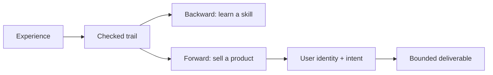
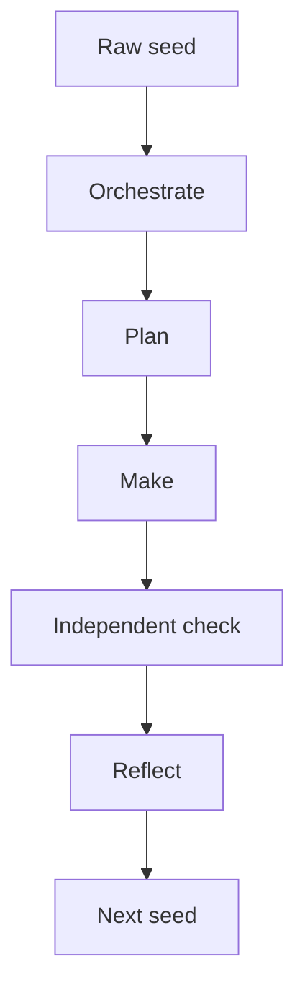

# Thought Transfer PMCR-O

Thought Transfer is a documentation-first prototype for translating philosophical lenses into bounded agent roles, declarative skills, and auditable PMCR-O trails.

The name is a project synthesis, not the name of an established theory. The repository combines:

- a Hofstadter-inspired lens for self-reference and emergent identity;
- a Buber-inspired lens for dialogue, relation, and the danger of reducing a participant to a thing;
- a von Neumann-inspired lens for constructors, descriptions, replication, and bounded recursion; and
- PMCR-O as the operational control loop that turns those lenses into inspectable artifacts.

## Important boundary

The `I AM` passages in `simulations/` are generated role-play. They are not historical quotations, not claims of consciousness, and not evidence that a historical philosopher is speaking through a model. Each voice is an interpretive lens with explicit limits, a handoff, and a checkerable artifact.

## What this repo demonstrates

1. A generic, template-driven `skill-creator` shape can be the default authoring surface.
2. `pmcro-orchestrator` can act as the control-plane entrypoint while skills and plugins remain replaceable artifacts.
3. Multiple accounts are modeled as distinct entrypoints and principals, not as implicit shared authority.
4. Every phase can have its own bounded agent surface. An independent checker is a separate producer/checker context, not merely another name for every phase agent.
5. Local terminal, Docker, MAF, Harness, CodeAct, and Figma are documented as adapters with explicit capability grants.
6. Git checkpoints plus append-only cognitive-trail events make “time travel” a read-only replay operation rather than a permission to rewrite history.
7. A future autonomous multi-AI company can be modeled as a collection of bounded domain chiefs and workers, with humans retaining policy authority.
8. A checked trail can flow backward into reusable skill design or forward into an identity-aware product experience.
9. A progressive flow skill can discover domain surfaces from the trail and generate redacted training candidates without confusing the archive with the dataset.
10. `templates/product-repo/` packages the same control plane for a friend-run Codex, Claude, Ollama, MAF, MCP, Harness, or CodeAct adapter with a finite autonomy grant and generic trail.

## Two directions of travel

The repo treats the same trail as a bridge between two directions:



Backward flow learns from evidence without turning one story into an absolute rule. Forward flow injects declared user identity and intent into a bounded product; it can optimize for “best seller” quality, but it must not promise a market outcome or impersonate the user.

## PMCR-O shape



The example trail in `.pmcro/trails/0001-source-seed.jsonl` is intentionally small. It records the source intent, charter, role graph, maker handoff, checker separation, and reflective next seed without pretending that this documentation repo is a production runtime.

## Quick start

From this directory:

```bash
python3 scripts/validate_repo.py
python3 -m unittest discover -s tests -v
git log --oneline --decorate -5
```

Expected result: the repository validator and the tests pass. The local Git history is the first replayable checkpoint; no remote is configured or pushed by this example.

For a separate model workspace, build the progressive activation bundle and load `00-core` first:

```bash
python3 scripts/build_activation_bundle.py \
  --repo . \
  --source-seed ../upload/'Pasted text(3).txt' \
  --commit "$(git rev-parse HEAD)" \
  --out-dir ../ai-studio-bundle
```

The later packets are requestable by exact package ID. The complete ZIP and simulated ZIP-as-text remain archive/replay artifacts rather than the default first-load context.

## Repository map

| Path | Purpose |
| --- | --- |
| `docs/` | Design notes, boundaries, adapters, and roadmap-level concepts |
| `simulations/` | Clearly labeled `I AM` role simulations |
| `skills/thought-transfer/` | Installable skill with the frame renderer and checker |
| `skills/progressive-trail-flow/` | Progressive domain discovery and trail-to-training projection skill |
| `skills/reflect/` | Marketplace `reflect` skill used by the reflector after a completed checker frame |
| `skills/pmcro-messages-protocol/` | Role-owned frames, queue wait contract, and bounded seed routing |
| `skills/pmcro-session-marketplace/` | Authorized-session ingest into redacted PMCR-O, marketplace, and training candidates |
| `.agents/` | Agent-surface metadata, plugin registry, and independent role declarations |
| `.pmcro/protocol/` | Small JSON contracts for trail events and phase envelopes |
| `.pmcro/trails/` | Append-only example trail |
| `templates/` | Declarative starter shape for a generic skill creator |
| `templates/product-repo/` | Provider-neutral product-repository starter with grant, agent surfaces, generic trail, and friend-run validators |
| `examples/` | A sample multi-phase company cycle |
| `scripts/` and `tests/` | Local structural checks |

## Scope and non-goals

This repository does not:

- claim that simulated voices are persons or conscious agents;
- grant authority merely because an account, model, or plugin is connected;
- execute Docker, MAF, CodeAct, Harness, or Figma actions;
- create a self-reproducing production system;
- rewrite Git history during replay; or
- install or promote a marketplace skill.

Those are future adapters or experiments. The current artifact is a checked conceptual and structural foundation.

## Source note

The initial intent was derived from the user-provided upload `Pasted text(3).txt`. The upload remains outside this repository; `.pmcro/trails/0001-source-seed.jsonl` stores a concise provenance-linked seed rather than duplicating the full transcript.
