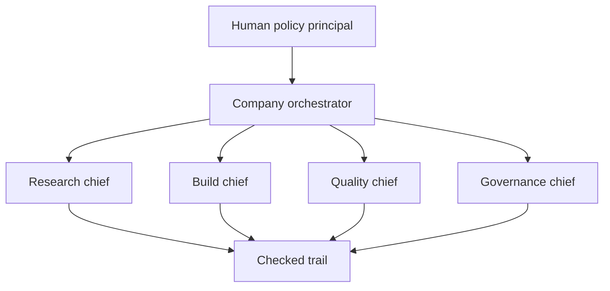

# A bounded autonomous multi-AI company

The “company” idea is useful as an organizational metaphor if every chief, department, and worker has a contract. It becomes unsafe when the metaphor is used to smuggle in unlimited authority.

## Proposed shape

Each chief can decompose a domain goal into bounded child roles. Each child role returns an artifact and evidence. The company orchestrator does not silently merge all tool authority; it composes handoffs.

## Role contract

Every chief should declare:

- mission and non-goals;
- principal and entrypoint;
- allowed tools and paths;
- budget, time, and depth limits;
- escalation conditions;
- checker requirement;
- promotion authority; and
- retention policy for its trail.

## Human policy boundary

Humans remain policy principals for actions with irreversible external impact, legal or financial commitment, identity-sensitive communication, or unclear stakeholder consent. “Autonomous” means the system can progress within a charter; it does not mean the system may redefine the charter.

## Roadmap seed

A future local machine with local models can be added as a provider or worker pool. The next useful experiment is a dry-run adapter that scores routing and handoff quality without granting network credentials or external-write authority.
